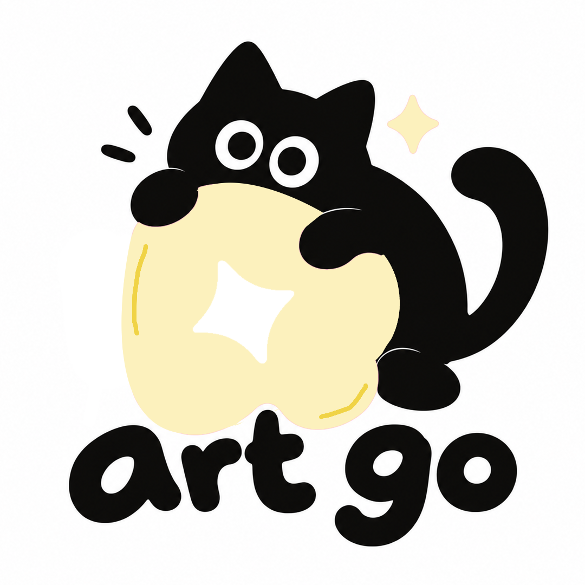
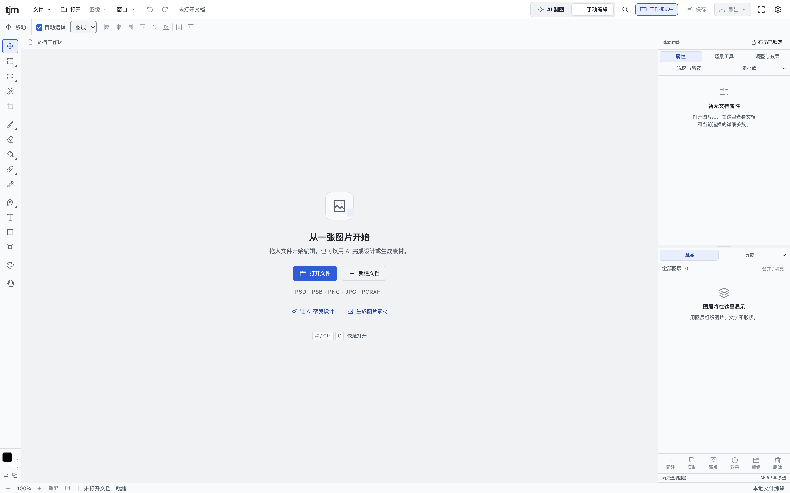

<div align="center">



# Art GO Agent

**Turn your own AI coding assistant into a graphic designer. It builds the design layer by layer in a real layered editor and hands you an editable PSD.**

English · [简体中文](README.zh-CN.md) · [日本語](README.ja.md)

[](LICENSE)


[How it works](#-how-it-works) · [Quick start](#-quick-start) · [What it does](#-what-it-does) · [CLI](#%EF%B8%8F-cli) · [Skills](#-custom-skills) · [License](#-license--trademarks)

</div>

---

## ✨ Why

Most AI design tools hand you one flattened image. Art GO Agent is **a design tool made for agents**. You describe what you want to your own coding assistant. The assistant then builds the design **layer by layer** with the same tools a person would use: text, shapes, selections, masks, adjustment layers, filters and layer styles. Every step stays in the layer stack and the history, and you get an editable PSD and a PNG at the end.

The reasoning is done by your coding assistant's own model, so **no extra LLM key is needed**. A key is only needed to generate image assets. Without one, the agent can still finish a whole design from your own assets.

## 🧭 How it works

```
you ──request──▶ your coding assistant (reads AGENTS.md)
                     │  artgo start / artgo call / artgo finish
                     ▼
                 artgo runtime (local, background) ──▶ TJM editor in a headless Chrome
                     │                               Rust→WASM engine · workflow · skills · asset library
                     ▼
                 projects/<name>/  brief · checkpoint · previews · document.psd · final.png
```

- **Enforced workflow**. The assistant cannot skip steps; calls that break these rules are rejected:
  - it must analyse the request, check assets and match a skill before it can edit;
  - a loaded skill limits which tools it may use;
  - destructive steps wait for your confirmation;
  - a full preview of the final canvas is required before delivery.
- **Visible results**. Every preview is a real render, saved as a PNG for the assistant to inspect. `artgo progress` gives a read-only progress page, and `artgo up --headed` lets you watch the layers appear in the editor.
- **Credit**. The organisation follows the "your coding assistant is the orchestrator" idea of [OpenMontage](https://github.com/calesthio/OpenMontage): AGENTS.md, pipeline guides, skills and project checkpoints. No OpenMontage code is used.

## 🖼 Editor & work

Run `artgo up --headed` to watch this editor; below is work made by the agent.



| | | |
| :---: | :---: | :---: |
| <br><sub>Character sheet</sub> | <br><sub>Commercial product photo</sub> | <br><sub>Brand identity board</sub> |

## 🚀 Quick start

You need Node 20+ and Google Chrome.

```bash
git clone https://github.com/<you>/artgo-agent.git
cd artgo-agent
npm ci
```

Open your coding assistant in this folder and ask, for example:

> Use ~/Downloads/product.png to make a 1080×1350 launch poster, title "Spring Collection", subtitle "20% off everything".

The assistant reads `AGENTS.md`, starts the runtime, creates a project and runs the workflow. When it is done, it tells you where `projects/<name>/document.psd` is.

**Try it without a key:** have the assistant start with `artgo up --mock`. Image generation is simulated and everything else works the same.

**For AI image generation**, enter the key yourself in a terminal. Don't paste it into the chat.

```bash
echo "$GEMINI_API_KEY" | node bin/artgo.mjs key add gemini     # also openai / glm / qwen / doubao
```

Keys, the asset library and settings stay in the local browser profile under `.artgo/chrome/`. Requests go straight to the vendor's official API with no relay server, and API usage is billed to your own account.

## 🧩 What it does

| Pipeline | What | Guide |
| --- | --- | --- |
| **Poster / banner** | Lays out your assets, or generates a background first; titles stay editable | `pipelines/poster.md` |
| **Revise** | Changes only the layers and fields the feedback names | `pipelines/revise.md` |
| **Text effects** | 12 presets (neon, metal, gold, sticker…), text warp, 3D extrusion | `pipelines/text-effects.md` |
| **Region edit** | Recolour, cut out, remove or generatively replace inside a selection, feathered into the surroundings | `pipelines/region-edit.md` |
| **Decompose** | Turns a flat image into editable PSD layers | `pipelines/decompose.md` |

There are also purpose constraints (e-commerce main image, 9:16 feed) and style skills such as `style-swiss-minimal`. The editor reads and writes PSD/PSB, PNG, JPEG, WebP and TIFF, and ships 19 commercially usable CJK and Latin fonts.

## ⌨️ CLI

Every command prints JSON, so any assistant can parse it. Run `node bin/artgo.mjs help` for the full list.

```bash
artgo up [--headed] [--mock]          # start · artgo down · artgo progress
artgo new poster --size 1080x1350     # or --image photo.jpg
artgo asset add product.png logo.png
artgo start "<the request, verbatim>"
artgo call report_analysis '{"goal":"…"}'
artgo call -f calls.json              # several calls in one turn
artgo finish "<summary>"
artgo export png|psd
artgo tools [name]                    # 37 tools and their parameter schemas
```

Every platform entry file points to the same `AGENTS.md`:

| Platform | Entry file |
| --- | --- |
| Claude Code | `CLAUDE.md` |
| Codex and others | `AGENTS.md` |
| Cursor | `.cursor/rules/` |
| GitHub Copilot | `.github/copilot-instructions.md` |
| Windsurf | `.windsurfrules` |
| Gemini CLI | `GEMINI.md` |

## 🔧 Custom skills

Drop a Markdown file with frontmatter into `skills/` to add a style, purpose, workflow or capability skill. The runtime syncs and publishes it on start. The format is in [`skills/README.md`](skills/README.md).

## 🗂 Layout

```
AGENTS.md            operating contract for the agent (every platform entry points here)
bin/artgo.mjs          CLI
runtime/             background runtime: Vite + Playwright Chrome + local JSON-RPC + progress page
pipelines/           stage-by-stage guides per task type
skills/              custom skills
src/                 editor (React + TypeScript)
src/agent-host/      external-agent adapter and page-side API
src/local/backend/   workflow, tool catalog, built-in skills, image adapters
engine/              Rust → WASM engine bridge (PhotoCraft v0.6.0)
projects/            your work (git-ignored)
```

## 🧪 Development

```bash
npm test               # unit tests
npm run typecheck
npm run smoke:agent    # end to end: real CLI + headless Chrome + simulated image generation
npm run dev            # editor UI only: http://127.0.0.1:5191
```

The runtime listens on `127.0.0.1` only. Each start writes a random token to `.artgo/runtime.json` (mode 600), and requests without it are refused.

## 🤝 Contributing

Issues and PRs are welcome. Run `npm test` and `npm run smoke:agent` before opening a PR. By contributing you agree to license your work under Apache-2.0 (section 5).

## 📄 License & trademarks

- **Code**: [Apache License 2.0](LICENSE), Copyright 2026 TJM.
  - You may use, modify and distribute it free of charge, including commercially.
  - Keep the license and [NOTICE](NOTICE) files, and state which files you changed.
  - The license includes a patent grant and comes **without warranty**.
- **Trademarks**: the TJM name, the logos in `public/brand/`, the lowercase "tjm" wordmark, and the Art GO name and logo (`docs/images/artgo-logo.png`) are **not** licensed (Apache-2.0 section 6). Forks must replace them and must not imply endorsement.
- **Third-party code**: PhotoCraft (MIT or Apache-2.0), plus vgpu, vgpu-optimized-black-hole, ag-psd, React, zustand and sql.js (all MIT). License texts are in [`third_party/`](third_party).
- **Design skill sources**: some built-in skills adapt ideas from MIT / Apache-2.0 projects; see [`third_party/design-skill-sources.md`](third_party/design-skill-sources.md).
- **Fonts**: SIL Open Font License 1.1, with the license file in each font folder.
  - Free to use in designs, including commercial use and embedding in exports.
  - The font files may not be sold on their own.
- **Your work and AI content**:
  - What you create is yours.
  - Generated content is also subject to your vendor's terms.
  - You are responsible for the rights to any assets you import.

<div align="center"><sub>For designers who want "AI, edit my design", not just "AI, make me a picture".</sub></div>
